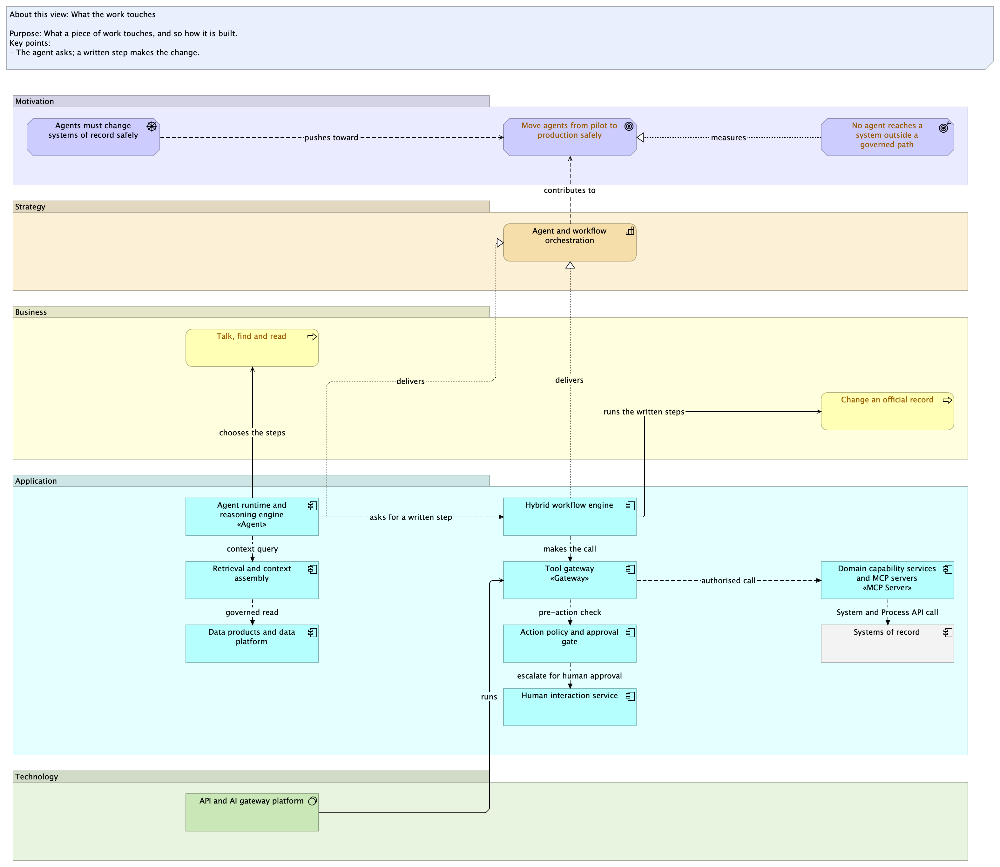

*You are here: Decision 1, on line I, the shape.*

# Agent or workflow? Ask what the work touches

*Vendors tell you to start small, and to keep fixed work out of agents. None I read draws the line at whether the work changes an official record, such as an appointment or a patient's record. Here is the question that does.*

**In this article**

- [First, three words](#first-three-words)
- [What the vendors say, and what they leave out](#what-the-vendors-say-and-what-they-leave-out)
- [Most agents already have a workflow inside](#most-agents-already-have-a-workflow-inside)
- [Why a record changes the answer](#why-a-record-changes-the-answer)
- [A quick sort](#a-quick-sort)
- [My position](#my-position)
- [Behind this answer](#behind-this-answer)
- [What this changes for you](#what-this-changes-for-you)
- [Why the business should care](#why-the-business-should-care)
- [Four questions for your board](#four-questions-for-your-board)
- [What no source says](#what-no-source-says)
- [Receipts](#receipts)

A chain of clinics, which I call the health network, has an AI pilot that works. What stands between it and production? This is the first of the decisions that answer that.

The assistant does many jobs. Each role has an assistant of its own, over several systems, and all of it is personal data:

- **Anna** finds a doctor by symptom, checks what her health plan covers, reads her own record and moves her appointment.
- **Dr Rao** uses it for her schedule and her patients' records.
- **Sam** registers patients and cancels appointments at the front desk, updates allergy and medication lists and has confirmations e-mailed.

The pilot's sponsor said, "One agent for all of it."

That sentence hides the first decision of an agentic programme. My answer is different for each kind of job:

- **Talking, finding and reading** is model-led work. Finding Anna a doctor may need only one call to a model, and it becomes an agent only if the model must choose its own steps.
- **Changing a record** belongs in fixed steps that people wrote down. Rescheduling an appointment, updating a medication list, registering a patient and sending a confirmation all change official records or send something out. An agent may ask for the change but never makes it.

If you fund this rather than build it, go to "Why the business should care".

## First, three words

An **agent** is software where an AI model decides the next step. A **workflow** is software that follows steps people wrote down in advance. A **system of record** is the system that holds the official version of a fact, such as the booking system for appointments.

If you run integration, you already own workflows: every flow on your platform is one, and a flow can still ask a model for help inside a step.

What is new is the agent. Nobody wrote its path down, and the model chooses, one step at a time, what to call next.

## What the vendors say, and what they leave out

On where to start, the guidance splits:

- **Microsoft** offers a ladder: ask a model once, then use one agent with tools, then several agents, and stop at the lowest rung that works reliably.
- **Anthropic** advises finding the simplest solution possible and adding complexity only when needed.
- **Salesforce** recommends starting with a single agent and adding more as the organisation grows.

They agree that you grow slowly. They differ on whether the first step can be no agent at all, which my architecture model records as an open conflict. Microsoft and Anthropic also say when to build none:

- Microsoft says that if you can write a function to handle the task, do that instead of using an AI agent.
- Anthropic says workflows offer predictability for well-defined tasks.

None of the guidance I read draws the line at the question I think comes first: does this work change a system of record? That line is my position. What I found is a reason for it, on consistency.

**Consistency.** The best-known test of agents on customer-service tasks, tau-bench, asks not only whether an agent succeeds once but whether it succeeds every time on the same task.

- In the 2024 paper, the best model tested solved about 61 percent of the retail tasks on one try.
- It solved about 25 percent or fewer when it had to get the same task right on eight runs in a row.

## Most agents already have a workflow inside

Few agents are one or the other: a team on an agent framework can call its assistant a workflow, and an agent.

- **Anthropic** notes that some customers use "agent" for systems that follow predefined workflows. It calls all of them agentic systems and keeps the difference.
- **LangGraph**, an agent framework, builds both from steps joined by paths. Its documentation says a workflow has predetermined paths and an agent defines its own, and a graph can pause at a step for a person's approval.
- **Microsoft** describes workflows that connect agents and functions through explicit paths.

So judge each step, not the product. Ask of every step who chose it, a person who wrote the path or the model at run time, and whether it can change a system of record.

A graph does not make a change safe by being a graph. If the model decides when the "move the appointment" step runs, the model decides.

In the health network, Anna's assistant can be built as a graph. The model may choose to look for a doctor. It may not choose to move her appointment: that step runs only after a written check and her confirmation.

No source I found says where such a step must sit. That is my position.

## Why a record changes the answer

A doctor the assistant suggests to Anna can be the wrong match, and what makes that safe is that Anna reads the answer and chooses.

Updating a medication list is different. It changes the system of record every clinician will trust, as rescheduling changes the booking system. You want the same steps in the same order every time, written down, tested and signed off by the people who own those systems.

The variation that makes an agent useful at matching symptoms to doctors is the thing you cannot afford on a medication list. An agent right on average is not right every time.

## A quick sort

Three questions place any step, in this order: does it change a system of record or send something out, can its steps be written down in advance, and if it is wrong, who sees it and when?

- **Reads only, and a person sees the result first.** The model may choose the path. In the health network: finding Anna a doctor by symptom. She reads the list and chooses.
- **Reads only, but nobody sees the result first.** The path is fixed in advance. In the health network: a note Anna leaves on her appointment, read later by Dr Rao's assistant.
- **Changes a record or sends something out, and the steps can be written down.** People write, test and sign them off. The model can only ask. In the health network: moving Anna's appointment, then e-mailing her the confirmation.

If the work changes a record but its steps cannot be written down, I do not hand it to an agent: a person does it until the steps can be written.

## My position

In my AI Agentic Reference Architecture, the sort has two halves.

- Allow an agent where the work is conversation or sorting, with a person overseeing it.
- Use a workflow wherever a system of record changes.

Within either half, use the lowest sufficient complexity: ask a model once before you build an agent, build one agent before several, and make several agents justify themselves with a budget for model cost.

I side with Microsoft and Anthropic against starting from an agent.

The assistant can listen to Anna, work out that she wants to move her appointment and ask for it. The workflow makes the change.

That holds inside a framework too: a step that changes a record is a written step, however the agent is built. Who decides what, between the two, is the next decision.

I rejected an agent first, everywhere: it demos well, but it varies most between runs and gives a model's judgment a path to your records.

I would change my mind if an enterprise measured, on its own tasks and over repeated runs, that an agent completes a record change every time, and a person still approves each change.

*From my AI Agentic Reference Architecture.*

## Behind this answer

*Business owners: this box is for architects. Skip to "Why the business should care", further down.*

How to read the view below:

- **Shapes and colours:** pale blue boxes are building blocks. Lilac shapes are principles ("!"), requirements (slanted), goals (a target) and the open conflict (a magnifier).
- **Arrows:** dotted with a hollow head means supports, dashed with a solid head means invokes, and a plain line means related to.
- **The two building blocks:** the Hybrid workflow engine runs the written steps and can invoke an agent step. The Agent runtime and reasoning engine runs the agent. Its long requirement box lists the run limits on every agent: a token budget, an iteration limit, a timeout, a circuit breaker (an automatic stop when something keeps failing) and a daily cost cap.
- **Direction:** the view shows a workflow invoking an agent step; the other direction in my picture is my position.
- **Two terms:** CLASSic is a set of five measures for an agent: cost, latency, accuracy, security and stability. pass^k is the share of tasks an agent gets right on k runs in a row.

*From the ArchiMate model of my AI Agentic Reference Architecture. View: "Agent or workflow".*

- **TOGAF phase:** principles belong to the preliminary phase, where the rules for all later work are set. The building blocks belong to the application phase, where the software pieces are chosen.
- **Tested or guidance:** "Lowest sufficient complexity" is realised (the model's word for supported) by two requirements, on repeated-run evaluation and on run budgets. "Agents for interaction, workflows for records" has nothing supporting it, so it is guidance.
- **A recorded conflict:** the model keeps "agent first" against "lowest sufficient complexity" open.

## What this changes for you

- **Integration architect.** Your flows stay as the way records change. The new work is letting an agent ask for them, and choosing which.
- **Security architect.** A fixed path gives you a place to put controls. The agent still writes the request, so its guess can reach the workflow. The workflow limits where it can land; the next decision covers who checks it.
- **Data architect.** An agent that reads data with an owner and access rules is a smaller risk than one that writes it. The data decisions later start from reading.

## Why the business should care

The pilot sounds like one purchase but is two kinds of work. Each has a bill for mistakes and a bill to run:

- **Talking, reading and sorting.** A person who reads the result first catches a mistake, as long as they keep reading. It is cheap to run if one model call is enough, and dearer if it needs an agent.
- **Changing records.** A mistake is an appointment cancelled for the wrong patient, a wrong allergy or a confirmation sent to the wrong person. It is cheap to run on fixed steps, once people have written, tested and signed them off.

Each step an agent decides is a paid call to the model. In Anthropic's own data on its research system, agents used about four times as many tokens as a plain chat, and teams of agents about fifteen times (a token is the unit a model is billed by, roughly a short word).

That is one vendor's figure about one system. Fixed steps cost less to run and can be audited but cost more to build, which is my reasoning, not a measured figure.

A demo in which the assistant does everything is not evidence that it should. When a team says its assistant is "just a workflow", ask which steps change a record or send something out, and whether people wrote them down beforehand.

One question for your chief operating officer: what would one wrong change to a patient's record cost us, and how many would we accept?

## Four questions for your board

1. Who has sorted every step of what we want the assistant to do by whether it changes a system of record, and where is that list kept?
2. For each one that changes a record, who owns the written steps today, and can an agent ask for them without replacing them?
3. For each agent we approve, what is the lowest rung that works, and who has measured it over repeated runs, not once?
4. Who signs off when a job asks to go up a rung, and what budget for model cost does it carry?

## What no source says

- No source I found tells you how to sort your own tasks into the two halves. The split by purpose is my architecture's own, a position and not an industry fact.
- The consistency figures come from 2024 models, one domain, and a paper whose appendices I did not read.
- The cost figures are one vendor's data about one system.

## Receipts

| Claim | Kind | Source | Dated |
|---|---|---|---|
| A workflow follows predefined code paths; an agent directs its own process | Vendor guidance | Anthropic, "Building effective agents" | Published 19 Dec 2024 |
| Find the simplest solution possible, add complexity only when needed | Vendor guidance | Anthropic, "Building effective agents" | Published 19 Dec 2024 |
| Use the lowest rung of the ladder that works reliably | Vendor guidance | Microsoft, "AI agent orchestration patterns", Azure Architecture Center | Updated 21 Sep 2026 |
| Start with a single agent | Vendor guidance | Salesforce Architects, "Enterprise Agentic Architecture and Design Patterns" | Date not shown |
| About 61 percent on one try, about 25 percent or fewer on eight runs in a row | Research | Yao, Shinn, Razavi and Narasimhan, tau-bench, arXiv 2406.12045 (ICLR 2025) | Preprint 17 Jun 2024 |
| Agents about four times the model usage of chat, teams of agents about fifteen times | Vendor data | Anthropic, "How we built our multi-agent research system" | 13 Jun 2025 |
| If you can write a function to handle the task, do that instead of using an AI agent; well-defined steps and an explicit order are reasons to use a workflow | Product documentation | Microsoft Learn, "Microsoft Agent Framework Overview" (the title on the browser tab), https://learn.microsoft.com/en-us/agent-framework/overview/ | Last updated 28 Oct 2026 |
| The simplest solution might mean not building an agentic system at all; workflows offer predictability for well-defined tasks | Vendor guidance | Anthropic, "Building effective agents", https://www.anthropic.com/research/building-effective-agents (address moved; earlier address https://www.anthropic.com/engineering/building-effective-agents; only the redirect was re-checked) | Published 19 Dec 2024 |
| Workflows have predetermined code paths; agents define their own processes and tool use; the same framework builds both from steps joined by paths; a graph can pause at a step and wait for a person's input | Product documentation | LangChain, LangGraph documentation, "Workflows and agents" and "Interrupts", https://docs.langchain.com/oss/python/langgraph/workflows-agents and https://docs.langchain.com/oss/python/langgraph/interrupts | No date shown |
| Some customers use "agent" for systems that follow predefined workflows; all are called agentic systems, and the difference between a workflow and an agent is kept | Vendor guidance | Anthropic, "Building effective agents", same page as above | Published 19 Dec 2024 |
| Workflows that connect agents and functions through explicit execution paths | Product documentation | Microsoft Learn, "Microsoft Agent Framework Overview", same page as above | Last updated 28 Oct 2026 |
| A step that changes a record is written by people however the agent is built; judge each step, not the product | My position | My AI Agentic Reference Architecture | Not applicable |
| Agents for conversation and sorting, workflows wherever a record changes | My position | My AI Agentic Reference Architecture | Not applicable |

Last verified: 2026-11-23.

**Next: who holds authority, the model or the services?**
