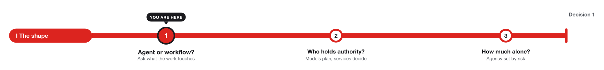
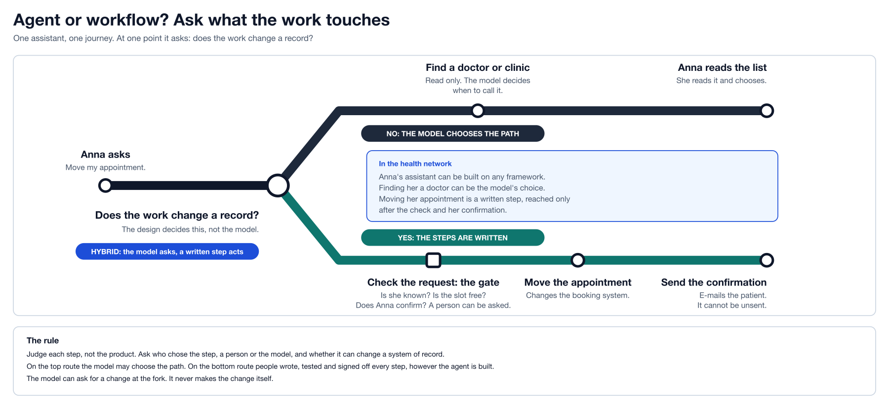
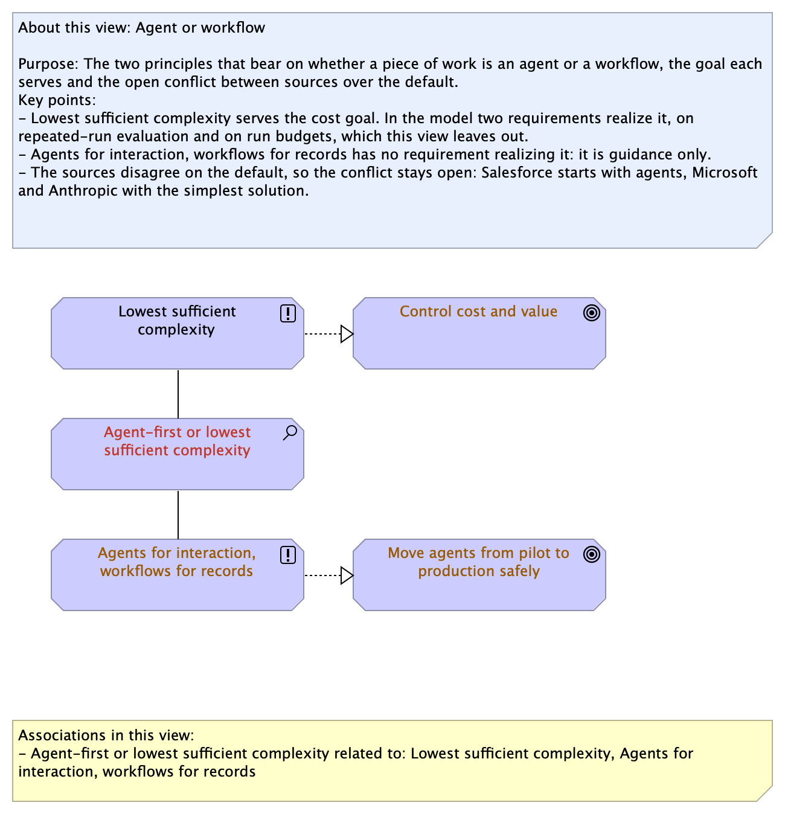

*You are here: Decision 1, on line I, the shape.*

# Agent or workflow? Ask what the work touches

*Vendors tell you to start small, and to keep fixed work out of agents. None I read draws the line at whether the work changes an official record. Here is the question that does.*

**In this article**

- [First, three words](#first-three-words)
- [What the vendors say, and what they leave out](#what-the-vendors-say-and-what-they-leave-out)
- [Most agents already have a workflow inside](#most-agents-already-have-a-workflow-inside)
- [Why a record changes the answer](#why-a-record-changes-the-answer)
- [A quick sort](#a-quick-sort)
- [My position](#my-position)
- [Behind this answer](#behind-this-answer)
- [What this changes for you](#what-this-changes-for-you)
- [Why the business should care](#why-the-business-should-care)
- [Four questions for your board](#four-questions-for-your-board)
- [What no source says](#what-no-source-says)
- [Receipts](#receipts)

A chain of clinics, which I call the health network, has an AI pilot that works. What stands between it and production?

The assistant does many jobs. Each role has an assistant of its own, over several systems, and all of it is personal data:

- **Anna** finds a doctor by symptom, checks what her health plan covers, reads her own record and moves her appointment.
- **Dr Rao** uses it for her schedule and her patients' records.
- **Sam** registers patients, cancels appointments, updates allergy and medication lists and sends confirmations.

The pilot's sponsor said, "One agent for all of it." That hides the first decision of an agentic programme. My answer differs by kind of job:

- **Talking, finding and reading** is model-led work. Finding Anna a doctor may need only one call to a model, and it becomes an agent only if the model must choose its own steps.
- **Changing a record** belongs in fixed steps that people wrote down. Rescheduling, updating a medication list, registering a patient and sending a confirmation all change official records or send something out. An agent may ask for the change but never makes it.

If you fund this, go to "Why the business should care".

## First, three words

An **agent** is software where an AI model decides the next step. A **workflow** is software that follows steps people wrote down in advance. A **system of record** is the system that holds the official version of a fact, such as the booking system for appointments.

If you run integration, you already own workflows, and a flow can still ask a model for help inside a step. What is new is the agent: nobody wrote its path down, and the model chooses what to call next.

## What the vendors say, and what they leave out

On where to start, the guidance splits:

- **Microsoft** offers a ladder: ask a model once, then use one agent with tools, then several agents, and stop at the lowest rung that works reliably.
- **Anthropic** advises finding the simplest solution possible and adding complexity only when needed.
- **Salesforce** recommends starting with a single agent and adding more as the organisation grows.

They agree that you grow slowly. They differ on whether the first step can be no agent at all, an open conflict in my architecture model. Microsoft and Anthropic also say when to build none:

- Microsoft says that if you can write a function to handle the task, do that instead of using an AI agent.
- Anthropic says workflows offer predictability for well-defined tasks.

None of the guidance I read draws the line at the question I think comes first: does this work change a system of record? That line is my position, and the best reason I found is consistency.

**Consistency.** The best-known test of agents on customer-service tasks, tau-bench, asks whether an agent succeeds every time on the same task, not only once.

- In the 2024 paper, the best model tested solved about 61 percent of the retail tasks on one try.
- It solved about 25 percent or fewer when it had to get the same task right on eight runs in a row.

## Most agents already have a workflow inside

Few agents are one or the other: a team can call the same assistant a workflow, and an agent.

- **Anthropic** notes that some customers use "agent" for systems that follow predefined workflows, calls all of them agentic and keeps the difference.
- **LangGraph** and **Microsoft** build both from steps joined by explicit paths, and a LangGraph graph can pause at a step for a person's approval.
- **Salesforce** built a graph for Agentforce: steps, some passing only after a check succeeds, with the model reasoning inside a step.

What the surveys say about how agents are built:

- **Most agents in use are bounded.** Gartner's survey of 360 IT application leaders found only 15% considering or running fully autonomous agents. A Berkeley-led preprint of 20 production case studies found 16 use structured workflows, and 68% of deployed agents run at most ten steps before a person steps in.
- **Vendors measure parts of it.** In Zapier's survey of 513 US managers, 77% whose agents mostly sit in automated workflows say agents finish most tasks alone, against 8% of the rest. UiPath found 52% of 590 executives name hybrid workflows, static and dynamic steps together, as next year's AI focus: intent, not practice.
- **What none of them asks.** No survey I found asks how many systems combine a written path with model decisions, and each means something different by "hybrid": agent plus workflow, build plus buy, copilot plus agent. So "most agents are hybrid" is my reading, not a measured fact.

So judge each step, not the product: who chose it, a person who wrote the path or the model at run time, and can it change a system of record?

A graph does not make a change safe by being a graph. If the model decides when the "move the appointment" step runs, the model decides.

No source I found says where such a step must sit. That is my position.

## Why a record changes the answer

A doctor the assistant suggests to Anna can be the wrong match, and what makes that safe is that Anna reads the answer and chooses.

Updating a medication list is different: every clinician will trust it. You want the same steps every time, written down, tested and signed off by the people who own the system.

The variation that makes an agent useful at matching symptoms to doctors is the thing you cannot afford there. An agent right on average is not right every time.

## A quick sort

Three questions place any step, in this order: does it change a system of record or send something out, can its steps be written down in advance, and if it is wrong, who sees it and when?

- **Reads only, and a person sees the result first.** The model may choose the path: finding Anna a doctor by symptom. She reads the list and chooses.
- **Reads only, but nobody sees the result first.** The path is fixed in advance: a note Anna leaves on her appointment, read later by Dr Rao's assistant.
- **Changes a record or sends something out, and the steps can be written down.** People write, test and sign them off. The model can only ask: moving Anna's appointment, then e-mailing her the confirmation.

If the work changes a record but its steps cannot be written down, I do not hand it to an agent: a person does it until the steps can be written.

## My position

In my AI Agentic Reference Architecture, the sort has two halves.

- Allow an agent where the work is conversation or sorting, with a person overseeing it.
- Use a workflow wherever a system of record changes.

Within either half, use the lowest sufficient complexity: ask a model once before you build an agent, build one agent before several, and make several justify themselves with a budget for model cost.

I side with Microsoft and Anthropic against starting from an agent.

The assistant can listen to Anna, work out that she wants to move her appointment and ask for it. The workflow makes the change.

That holds inside a framework too: a step that changes a record is a written step, however the agent is built.

I rejected an agent first, everywhere: it demos well, but it varies most between runs and gives a model's judgment a path to your records.

I would change my mind if an enterprise measured, on its own tasks over repeated runs, that an agent completes a record change every time, and a person still approves each change.

*Logical view: my own metro-map drawing of how one assistant works, from my AI Agentic Reference Architecture.*

## Behind this answer

*Business owners: this box is for architects. Skip to "Why the business should care".*

The logical view above is my own simplified drawing. The ArchiMate views below come from the formal model of the architecture. How to read the first: five bands from the top, each in its own colour.

- **Motivation and strategy (violet, orange):** the target, to move agents from pilot to production safely, measured by no agent reaching a system outside a governed path. One capability, agent and workflow orchestration, contributes to it.
- **Business (yellow):** the two kinds of work.
- **Application (cyan):** the hybrid. The agent runtime and reasoning engine chooses the steps for reading, using retrieval and context assembly (fetching the right facts for one request). To change a record it asks the hybrid workflow engine, which runs the written steps.
- **One door, one gate:** each change passes the tool gateway, the door, and the action policy and approval gate, which checks it and can ask a person. Only the domain capability services, the business functions in front of each system, call the records.
- **Technology (green):** an API and AI gateway platform runs the door.

*ArchiMate view, from the model of my AI Agentic Reference Architecture. View: "What the work touches".*

- **The principles behind it:** the second view shows the two principles behind the answer, with the goals they serve.

*ArchiMate view, from the model of my AI Agentic Reference Architecture. View: "Agent or workflow".*

- **Tested or guidance:** two requirements, repeated-run evaluation and run budgets, support "lowest sufficient complexity". "Agents for interaction, workflows for records" has no support in the model, so it is guidance. The model keeps "agent first" against "lowest sufficient complexity" as an open conflict.

## What this changes for you

- **Integration architect.** Your flows stay as the way records change. The new work is letting an agent ask for them.
- **Security architect.** A fixed path gives you a place to put controls. The agent still writes the request, so its guess can reach the workflow, which limits where it can land.
- **Data architect.** An agent that reads data with an owner and access rules is a smaller risk than one that writes.

## Why the business should care

The pilot sounds like one purchase but is two kinds of work, each with a bill for mistakes and a bill to run:

- **Talking, reading and sorting.** A person who reads the result first catches a mistake, as long as they keep reading. It is cheap to run if one model call is enough.
- **Changing records.** A mistake is an appointment cancelled for the wrong patient, a wrong allergy or a confirmation sent to the wrong person. It is cheap to run on fixed steps, once people have signed them off.

Each step an agent decides is a paid call to the model. In Anthropic's own data on its research system, agents used about four times the tokens of a plain chat, and teams of agents about fifteen times (a token is the unit a model is billed by). That is one vendor's figure about one system.

Fixed steps cost less to run and can be audited but cost more to build, which is my reasoning, not a measured figure.

When a team says its assistant is "just a workflow", ask which steps change a record or send something out, and whether people wrote them down first.

One question for your chief operating officer: what would one wrong change to a patient's record cost us, and how many would we accept?

## Four questions for your board

1. Who has sorted every step of what we want the assistant to do by whether it changes a system of record, and where is that list kept?
2. For each one that changes a record, who owns the written steps today, and can an agent ask for them without replacing them?
3. For each agent we approve, what is the lowest rung that works, and who has measured it over repeated runs?
4. Who signs off when a job asks to go up a rung, and what budget for model cost does it carry?

## What no source says

- No source I found tells you how to sort your own tasks into the two halves. The split is my architecture's own position, not an industry fact.
- The consistency figures come from 2024 models, one domain, and a paper whose appendices I did not read.
- The cost figures are one vendor's data about one system.

## Receipts

| Claim | Kind | Source | Dated |
|---|---|---|---|
| A workflow follows predefined code paths; an agent directs its own process | Vendor guidance | Anthropic, "Building effective agents" | Published 19 Dec 2024 |
| Find the simplest solution possible, add complexity only when needed | Vendor guidance | Anthropic, "Building effective agents" | Published 19 Dec 2024 |
| Use the lowest rung of the ladder that works reliably | Vendor guidance | Microsoft, "AI agent orchestration patterns", Azure Architecture Center | Updated 21 Sep 2026 |
| Start with a single agent | Vendor guidance | Salesforce Architects, "Enterprise Agentic Architecture and Design Patterns" | Date not shown |
| About 61 percent on one try, about 25 percent or fewer on eight runs in a row | Research | Yao, Shinn, Razavi and Narasimhan, tau-bench, arXiv 2406.12045 (ICLR 2025) | Preprint 17 Jun 2024 |
| Agents about four times the model usage of chat, teams of agents about fifteen times | Vendor data | Anthropic, "How we built our multi-agent research system" | 13 Jun 2025 |
| If you can write a function to handle the task, do that instead of using an AI agent; well-defined steps and an explicit order are reasons to use a workflow | Product documentation | Microsoft Learn, "Microsoft Agent Framework Overview" (the title on the browser tab), https://learn.microsoft.com/en-us/agent-framework/overview/ | Last updated 28 Oct 2026 |
| The simplest solution might mean not building an agentic system at all; workflows offer predictability for well-defined tasks | Vendor guidance | Anthropic, "Building effective agents", https://www.anthropic.com/research/building-effective-agents (address moved; earlier address https://www.anthropic.com/engineering/building-effective-agents; only the redirect was re-checked) | Published 19 Dec 2024 |
| Workflows have predetermined code paths; agents define their own processes and tool use; the same framework builds both from steps joined by paths; a graph can pause at a step and wait for a person's input | Product documentation | LangChain, LangGraph documentation, "Workflows and agents" and "Interrupts", https://docs.langchain.com/oss/python/langgraph/workflows-agents and https://docs.langchain.com/oss/python/langgraph/interrupts | No date shown |
| Some customers use "agent" for systems that follow predefined workflows; all are called agentic systems, and the difference between a workflow and an agent is kept | Vendor guidance | Anthropic, "Building effective agents", same page as above | Published 19 Dec 2024 |
| Workflows that connect agents and functions through explicit execution paths | Product documentation | Microsoft Learn, "Microsoft Agent Framework Overview", same page as above | Last updated 28 Oct 2026 |
| Agentforce models a business process as a graph of steps and transitions; some transitions are guarded by checks that must pass; each step is a focused reasoning agent | Vendor guidance | Salesforce Engineering, "Building Enterprise AI Agents That Are Both Autonomous and Reliable", https://engineering.salesforce.com/?p=8509, and "Agentforce's Agent Graph: Toward Guided Determinism with Hybrid Reasoning", https://engineering.salesforce.com/?p=7847 (both read in full) | Posted 6 Jul and 20 Oct; the year is not shown on either page |
| Only 15 percent of 360 IT application leaders surveyed (May and June 2025) are considering, piloting or deploying fully autonomous agents | Reported | Gartner, press release "Gartner Survey Finds Just 15% of IT Application Leaders Are Considering, Piloting, or Deploying Fully Autonomous AI Agents", https://www.gartner.com/en/newsroom/press-releases/2025-09-30-gartner-survey-finds-just-15-percent-of-it-application-leaders-are-considering-piloting-or-deploying-fully-autonomous-ai-agents (read from Gartner's mirror host because the newsroom address was refused; the report itself was not read) | 30 Sep 2025 |
| 16 of 20 production case studies use structured workflows; 68 percent of deployed agents run at most ten steps before a person steps in | Research | Pan and others, "Measuring Agents in Production", arXiv 2512.04123 (preprint, not shown to be peer reviewed; abstract, sections 3 to 7 and appendix B read) | Preprint Dec 2025 |
| Among 513 US managers, 77 percent say agents finish most tasks alone where more than half of agents sit in automated workflows, 8 percent where half or fewer do | Vendor data | Zapier, "88% of enterprises now use or test AI agents, but most still need a human in the loop", https://zapier.com/blog/ai-agents-survey/ (survey run by Centiment, 16 to 21 Sep 2026; Zapier sells workflow automation) | 9 Nov 2026 |
| 52 percent of 590 executives name hybrid workflows, static and dynamic together, as their AI focus for the next twelve months | Vendor data | UiPath, press release on its AI adoption and orchestration survey, https://www.uipath.com/newsroom/uipath-ai-adoption-orchestration-survey-2026 (survey 25 May to 8 Jun 2026) | 9 Sep 2026 |
| A step that changes a record is written by people however the agent is built; judge each step, not the product | My position | My AI Agentic Reference Architecture | Not applicable |
| Agents for conversation and sorting, workflows wherever a record changes | My position | My AI Agentic Reference Architecture | Not applicable |

Last verified: 2026-11-26.

**Next: who holds authority, the model or the services?**
