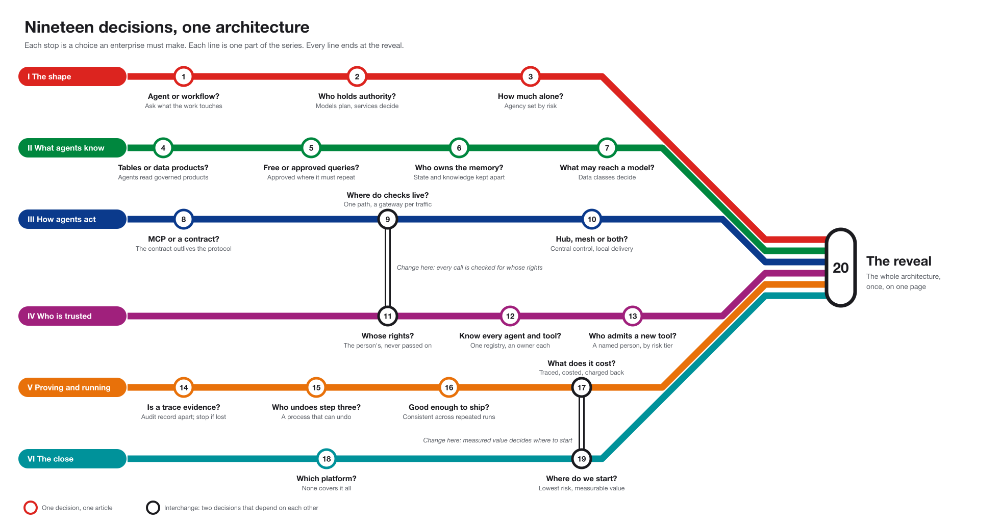

# The decisions that stand between an agentic pilot and production

*A series for architects and the business owners who fund their work: one use case, a set of decisions, one map.*

**In this article**

- [Why pilots stall](#why-pilots-stall)
- [The decisions](#the-decisions)
- [What each article gives you](#what-each-article-gives-you)
- [Why the business should care](#why-the-business-should-care)
- [Four questions to take to your board now](#four-questions-to-take-to-your-board-now)
- [What no source says](#what-no-source-says)
- [Receipts](#receipts)
- [The articles](#the-articles)

Every decision in this series is taken against one use case. A chain of clinics, which I call the health network, has an AI pilot that works. The question is what stands between it and production. Two words first:

- An **agent** is software where an AI model decides the next step.
- By **architecture** I mean the design decisions that hold whichever model you use: who may do what, which systems it may touch, how it is checked and what record it leaves. An **agentic** architecture is one built to run agents safely in an enterprise.

![The use case. A chain of clinics, which I call the health network, has an AI pilot: one assistant that works across its daily work, which is appointments, health records, patients, visits, follow-ups and booking payments. Each role has an assistant of its own. Behind it are six systems, each its own server behind gateways: booking, patient records, visits and follow-ups, payments, directory and messages. The people: Anna, a patient, who reaches only her own data. Dr Rao, a doctor, who reaches her own patients. Sam, a receptionist, who reaches any patient at the front desk. Priya, an administrator, who runs the back office and sets what each assistant may do. The pilot works. What stands between it and production? The network and its people are invented, and none of it is evidence.](00-prologue/assets/use-case.png)

*The use case that runs through every decision in the series. The network and its people are invented.*

Getting to production means settling questions that have nothing to do with the AI model, which already works:

- Which patients' records may it read, and which parts of a record does it see?
- Who can show afterwards what it read, and for whom?
- Who approves a change the assistant asks for, such as updating a medication list?
- Which systems may it change?
- Whose name goes on the record when it gets one wrong?
- Who pays each time the model runs?

Those are some of the decisions that stand between this pilot and production. Each article takes one decision and answers it against this same use case.

If you fund this work rather than build it, each article has a short section for you, called "Why the business should care". The prologue's is below.

## Why pilots stall

Many pilots stop at questions like these, and my claim is that much of what stops them is architecture, not the model. The evidence is thinner than I would like, so here is exactly what it is:

- The press reports that Gartner expects over 40 percent of agentic AI projects to be cancelled by the end of 2027.
- The reasons given are escalating costs, unclear business value and inadequate risk controls.
- I read two press reports of that forecast, not the Gartner release itself. Treat the number as reported, not confirmed.
- The same coverage quotes a Gartner analyst saying that many use cases positioned as agentic do not need agentic implementations at all.

Look at the three reasons:

- **Escalating cost and inadequate risk controls** are design problems. They are decided by how the thing is built, and an architect can do something about them.
- **Unclear business value** is a different kind of problem. It belongs to the business.

Good design cannot fix an idea with no clear value. It does decide how much cost and risk a good idea carries.

## The decisions

The answer to that question is a set of choices your enterprise has to make, such as whether a piece of work should be done by an agent or by fixed steps that people wrote down in advance.

The question breaks into six parts, and each part is one line of the series:

- **Should answering a patient and changing her record be built the same way?** Decisions 1 to 3, on the shape of an agent and who has the final say.
- **What may it read, and what may reach a model?** Decisions 4 to 7, on what agents know.
- **What may it touch, and where are the checks?** Decisions 8 to 10, on how agents act.
- **Who does it act as, and who admits a new tool?** Decisions 11 to 13, on who and what is trusted.
- **What record does it leave, and what if a step fails?** Decisions 14 to 17, on proving it and running it.
- **Which platform, and where do we start?** Decisions 18 and 19, the close.

Here is the list as it stands today, on one page. I may merge decisions or add one as the series goes. This is the only time you see the whole series at once. From here on, each article opens with a strip that shows only the line you are on and where you are on it.

*The series as a map. The labels are short names; each article gives the full wording.*

Read it like a metro map:

- **Each numbered stop is one decision, and one article.** The bold line is the choice, and the grey line under it is my answer in a few words.
- **The black-ringed stops are interchanges.** Two decisions depend on each other, and you can change between lines there.
- **All six lines end at the reveal.** A final article shows the whole architecture on one page and how each decision built a piece of it.

The architecture itself stays hidden until the end. You will see it grow, one part per decision, and see all of it only in the reveal.

## What each article gives you

Architects get most of every article. You are an enterprise, solution, integration, security or data architect, and agentic is new to you. I will not explain your own domain, only how an agent changes it, and I give a term from someone else's domain one plain sentence. Business owners get one short section, in plain words, that does not ask you to know the architecture. Every article has the same parts:

- A decision, asked as a question someone in your organisation will put to you.
- Who says what, each source labelled as what it is. Where no source speaks, I say so.
- My answer, marked as my position, with what it changes for the integration, security and data architect.
- A note for the business, and one question for the executive who owns the answer.
- A box for architects, "Behind this answer". It names the phase of TOGAF, the standard method for enterprise architecture, the rule of design the answer rests on, the building blocks that carry it (the named pieces of the architecture) and whether a requirement (a statement a test can check) covers it. When an answer is only my guidance and nothing tests it, the box says so. Business owners can skip it.
- Four questions to take to your board.

The answers come from two reference architectures, reusable designs that I built as architecture models, not as slide decks:

- **The AI Agentic Reference Architecture** follows TOGAF: one model in ArchiMate, the open notation for drawing enterprise architecture, with views for every phase and chapters of text around it.
- **My MCP Reference Architecture** goes deeper into how agents reach tools, the services and systems an agent can call, through **MCP**, a published standard way for an agent to find and call them. It has its own model.

That is how you can check an answer, challenge it and reuse it. What I will not do:

- Write tutorials or code, or pitch a vendor.
- Make a claim stronger than its source.
- Present my own position as an industry fact. Where my architecture goes further than anything published, I mark it as my position, and you can disagree.

## Why the business should care

Of the three reasons reported for cancelled projects, unclear value is the business's to answer from the start. The other two, cost and weak risk controls, cost the business money and trust long before they trouble an architect. Someone in the business has to say:

- what the assistant is worth;
- what it may cost;
- what mistakes the network will and will not accept.

Each article's business section gives you the cost or value of the decision, one moment in the network told from your side, and one question for you to answer or hand to your architects. It uses plain words and only terms the article has already introduced. You do not need to read the architecture parts to use it.

One question for your executive sponsor: if the assistant showed one patient another patient's record, or moved an appointment wrongly, who on the executive team would answer for it, and what would they want to have seen first?

## Four questions to take to your board now

If the board asked tomorrow, could you answer these?

1. Which of our AI proposals act on our systems, and which only read or draft?
2. Who decides what an agent may do on its own, and where is that written down?
3. Could we show an auditor what an agent did last Tuesday, and whose authority it acted under?
4. Who pays for it when it runs, and how would we know?

If you cannot answer them today, the articles that follow are for you.

## What no source says

- The model of my AI Agentic Reference Architecture follows the contents of TOGAF 9.2. I could not read the text of the 10th Edition, so I claim none of its section numbers.
- No source says these are the decisions. They are my selection from my two architectures, and I changed the list while planning it, so another architect might choose differently.

## Receipts

| Claim | Kind | Source | Dated |
|---|---|---|---|
| Over 40 percent of agentic AI projects expected to be cancelled by the end of 2027 | Reported | Reuters, "Over 40% of agentic AI projects will be scrapped by 2027, Gartner says", carried by The Star. The Gartner release itself was not read | 25 Jun 2025 |
| The reasons given: escalating costs, unclear business value, inadequate risk controls | Reported | W.Media, "Over 40 percent of Agentic AI projects could face the axe by end of 2027: Gartner", quoting the Gartner release | 27 Jun 2025 |
| Many use cases positioned as agentic do not need agentic implementations | Reported | W.Media, same article, quoting a Gartner analyst | 27 Jun 2025 |
| Pilots stall on architecture, and a governed design addresses the architectural part | My position | My AI Agentic Reference Architecture | Not applicable |
| The decisions and their order | My position | My AI Agentic Reference Architecture and my MCP Reference Architecture, drafts | Not applicable |

**Next: decision 1. Agent or workflow? Ask what the work touches.**

## The articles

Each article is a folder with its page and its images at full size.

- [Agent or workflow? Ask what the work touches](01-agent-or-workflow/README.md)
